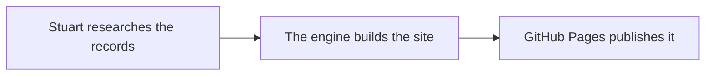
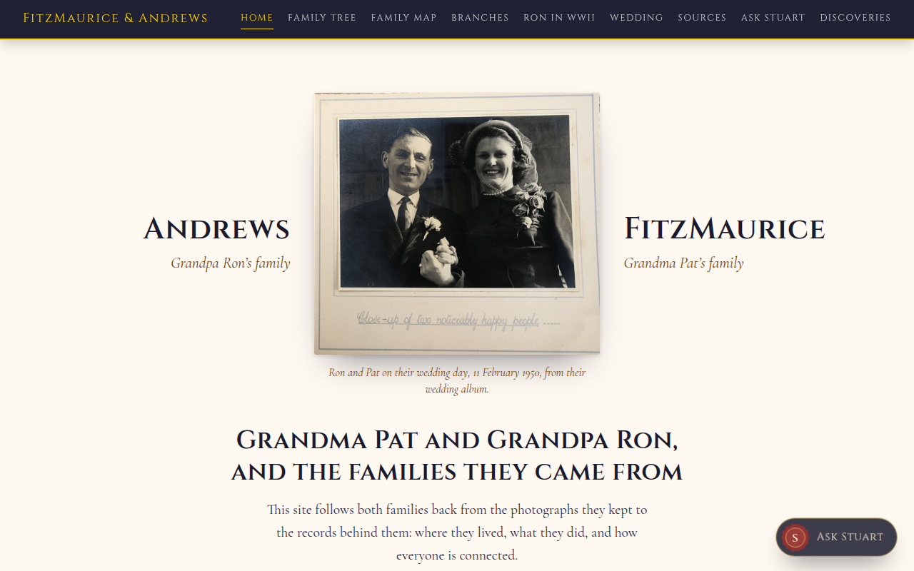
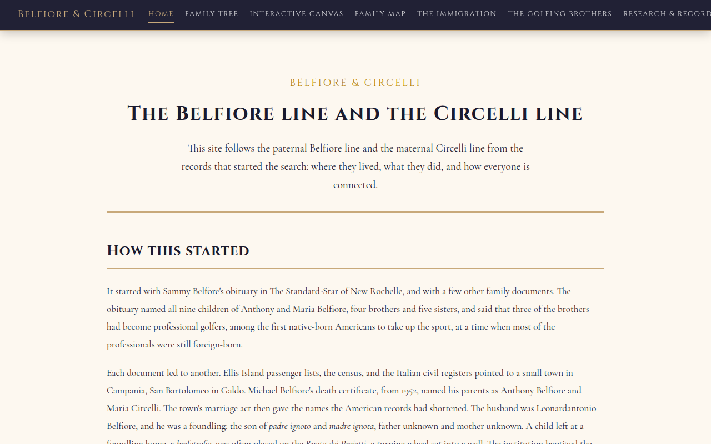
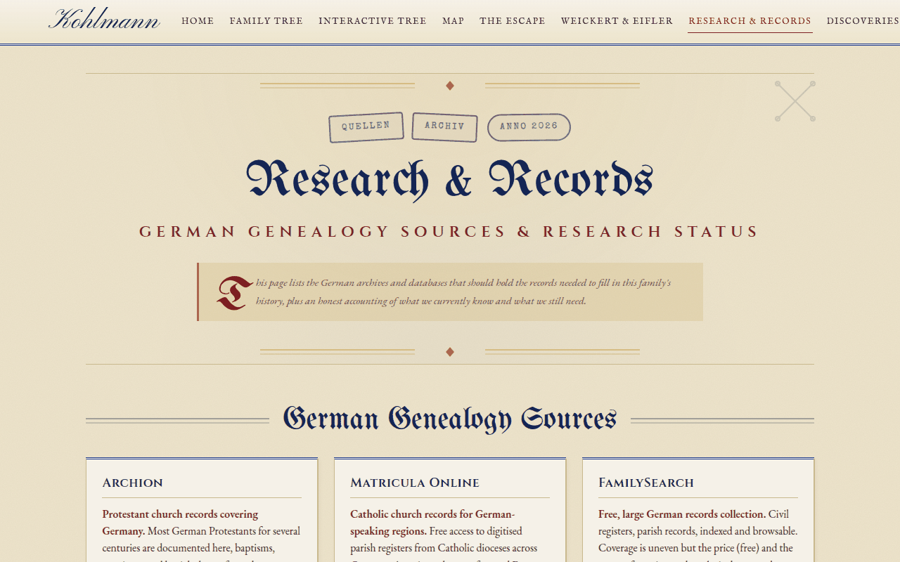
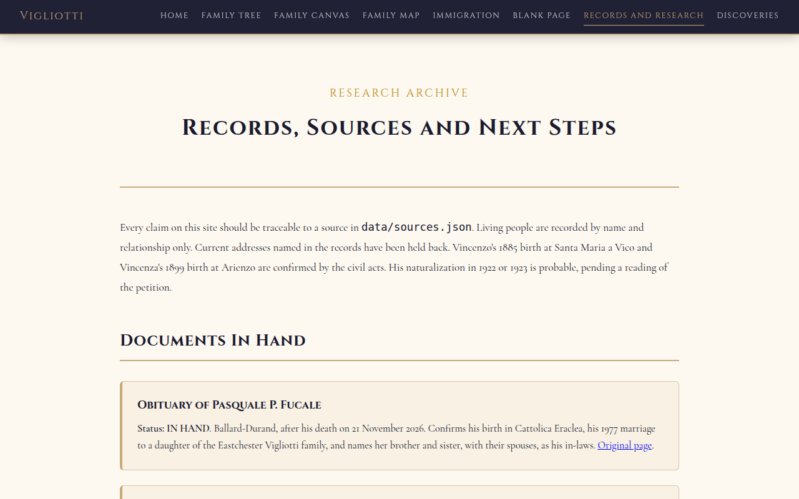
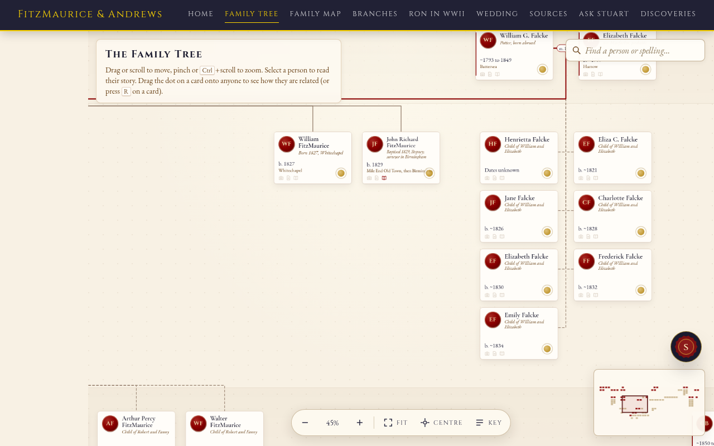
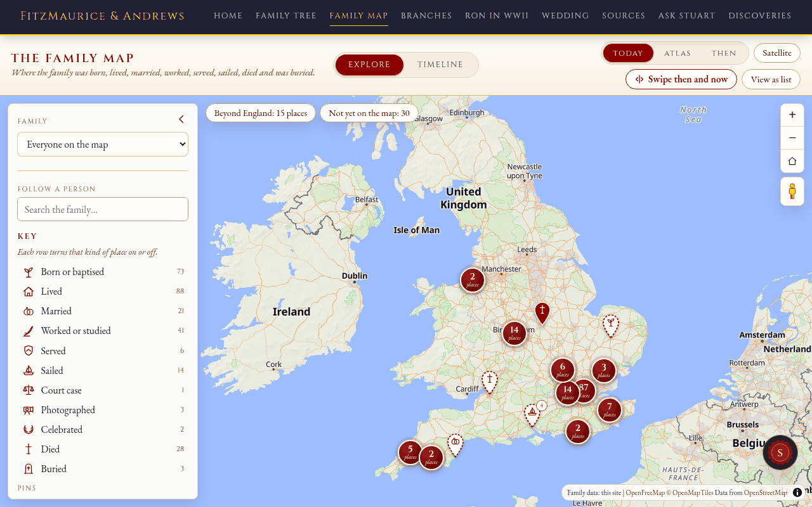
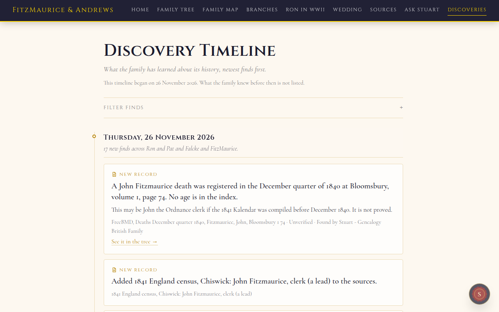
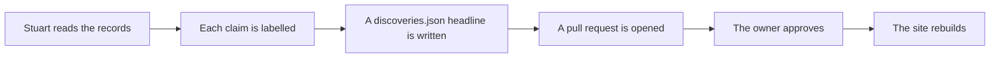
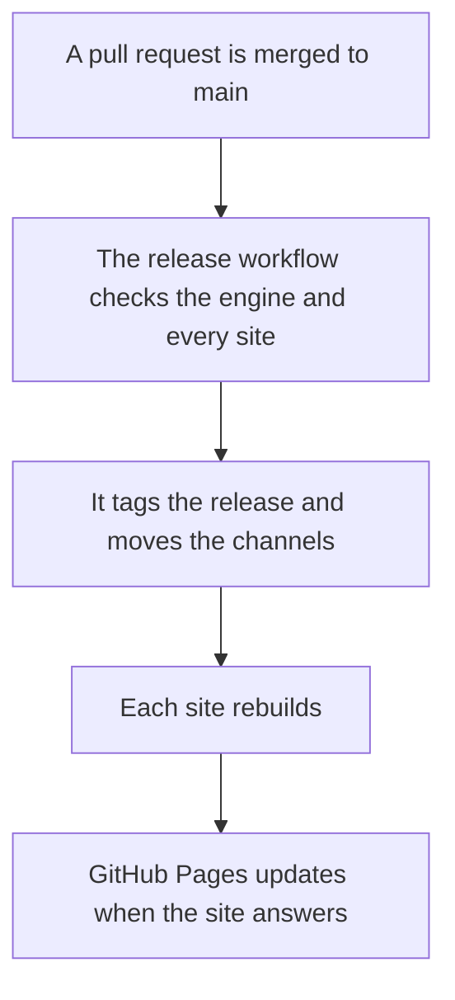

# Stuart Genealogy Research Engine

Family history sites, built from the records.


[](https://github.com/Belfiore/family-site-engine/releases/latest)
[](https://github.com/Belfiore/family-site-engine/actions/workflows/ci.yml)
[](LICENSE)

[Live examples](#live-examples) · [Get Stuart](#meet-stuart) (`STUART_TEMPLATE_LINK`) · [Set up your site](#set-up-your-site)

`STUART_TEMPLATE_LINK` is a placeholder. The Grok Bot template is not published yet.

## What it is

This repository is the engine. A family keeps its own data, photographs and stories in its own repository. The engine checks that data, builds a static site, and GitHub Pages publishes it. A fix made here reaches every site through a release: merging a pull request to `main` makes that release and rebuilds the sites. See [Releases](docs/releasing.md). Nobody copies engine files from one repository to another.

Stuart is the genealogist on top of the engine. He is a Grok Bot: he researches with the records, labels how sure each claim is, writes a headline for every new find, and stages the update as a pull request. The owner approves it before the site changes. On the published site, a visitor can ask Stuart questions from those same records.



The built site is plain files. Nothing in it loads code from anywhere else at run time, so a copy keeps working on its own.

## Live examples

Four family sites build with this engine. Each one follows a channel in [`sites.json`](sites.json). The version that channel builds with is in [`channels.json`](channels.json). When a channel moves, the sites rebuild on their own.

| | Family | Channel | Live site |
| --- | --- | --- | --- |
|  | FitzMaurice & Andrews<br>[Belfiore/English-Family-History](https://github.com/Belfiore/English-Family-History) | canary | [belfiore.github.io/English-Family-History](https://belfiore.github.io/English-Family-History/) |
|  | Belfiore & Circelli<br>[Belfiore/italian-belfiore-hertiage-lineage](https://github.com/Belfiore/italian-belfiore-hertiage-lineage) | stable | [belfiore.github.io/italian-belfiore-hertiage-lineage](https://belfiore.github.io/italian-belfiore-hertiage-lineage/) |
|  | Kohlmann<br>[Belfiore/kohlmann-heritage](https://github.com/Belfiore/kohlmann-heritage) | stable | [belfiore.github.io/kohlmann-heritage](https://belfiore.github.io/kohlmann-heritage/) |
|  | Vigliotti<br>[Belfiore/Vigliotti-Heritage](https://github.com/Belfiore/Vigliotti-Heritage) | stable | [belfiore.github.io/Vigliotti-Heritage](https://belfiore.github.io/Vigliotti-Heritage/) |

FitzMaurice tries releases first (canary). The other three stay on stable. All four have the family tree, the family map and the Discovery Timeline. FitzMaurice also has Ask Stuart. The pictures above are pages from those sites.

## Pages

### Home


The family's own front page (`index.html`). The engine gives it one navigation bar, and the Ask Stuart button when that page is turned on.

### Stories

Coming soon. The engine does not yet have a Stories page, a blank canvas set aside for a family's own stories. A site can already write story pages as ordinary HTML. Stuart reads the ones named in `stuart.pages`.

### Family Tree



An interactive tree (`templates/tree.html`). Cards, connecting lines, and a badge for how sure a link is. A living person is marked living.

### Family Map



Places on a map, with a timeline you can play (`templates/map.html`). Births, homes, marriages, work, voyages, deaths and burials can each be switched on.

### Records and Research


A page the site writes itself. Kohlmann calls it Research & Records, FitzMaurice calls it Sources, and Vigliotti calls it Records and Research. It is the finding list: the record, how sure the claim is, and where to open it again. The engine's record viewer opens the document from a person's card.

### Discoveries



The Discovery Timeline, newest finds first. It is off unless `timeline.enabled` is true. Each card is one find, with a headline, the source, and how sure it is. A visitor sees what is new since their last visit. The page is `discoveries.html`.

## Admin and settings

Coming soon: per-site page toggles and an `/admin` page, edited in the browser. That is not built yet.

What a site can set today is [`site.config.json`](docs/site-config.md), checked against `schema/site-config.schema.json` on every build. Only `schemaVersion`, `site` and `nav` are required. Everything else has a default that keeps today's behaviour.

| Setting | What it does |
| --- | --- |
| `engine.channel` | Which releases the site takes: `stable`, `beta` or `canary`. |
| `engine.version` | Optional. Pins the site to one engine version and ignores the channel until the pin is removed. |
| `pages.home`, `pages.tree`, `pages.map`, `pages.ask` | The file name of that page, or `null` to leave it out. A page left out loses every link to it. |
| `timeline.enabled` | The Discovery Timeline. Off unless set to true. `timeline.file` names the page (default `discoveries.html`). |
| `nav` | The shared navigation bar, in order. |
| `theme`, `tree`, `map`, `stuart` | Colours, and how the tree, the map and Stuart behave for this family. |

`sample/site.config.json` is a complete example, using a made-up family.

## Meet Stuart


Stuart is pictured by a portrait of Edward, great grandfather of the project's creator, taken at the Stuart studio in Knightsbridge, London.


### What Stuart does

Stuart works from records, and he says how sure he is.

- **The claim ledger.** Every claim in the data can carry a `confidence`: `confirmed` (a record says it), `probable`, `family tradition`, or `unverified`, plus the sources it rests on. The tree draws an unconfirmed parent link dashed, and Stuart says so when a link in an answer is not confirmed. See [the data format](docs/data-format.md).
- **A headline for every new find.** He writes it in `data/discoveries.json`, or as a `discovery` note on the record: the date, the headline, who found it, the source, and the confidence. The Discovery Timeline shows that sentence. With no note, the build writes a plain headline from the data. The notes file is read by the build and is not published as it stands.
- **A pull request the owner approves.** Stuart stages the update on the site repository. Nothing is published until the owner merges it. The site then rebuilds, and GitHub Pages updates when the checks pass.



### Set up the Grok Bot

Stuart the researcher is a Grok Bot, started from a template. The template link is not published yet:

`STUART_TEMPLATE_LINK`

When that link is real, use it in place of the placeholder above. The bot should have access to the site repository, and it should open pull requests rather than push to the live branch.

On the published site, Ask Stuart is a separate thing: a page that answers from the records in the visitor's browser. Nothing a visitor types leaves the page. Turn it on with `pages.ask` (usually `ask.html`) and a `stuart` block. FitzMaurice has this page. The other three sites leave it off. Details are in [Stuart](docs/stuart.md).

### Questions to ask

These use the made-up Hartley and Moreau family in `sample/`:

- How was Thomas Hartley related to Grandpa Arthur?
- Who came from France?
- What evidence is there for Arthur Hartley's birth?
- Where did Jean-Baptiste Moreau live?

## Set up your site

The made-up family in `sample/` is a complete site to copy. The longer version of these steps is [Adding a site](docs/adding-a-site.md).

1. **Create a repository** for the family, public, or private if the GitHub plan includes Pages for private repositories. Copy the sample into it and replace the Hartley and Moreau names with the real family:

   ```sh
   cp -a /path/to/family-site-engine/sample/. .
   ```

2. **Write `site.config.json`.** At the least, set `site.name`, `site.familyName`, `nav`, and `engine.channel`. Use `stable` unless this site is meant to try releases early. Point an editor at the schema:

   ```json
   { "$schema": "https://raw.githubusercontent.com/Belfiore/family-site-engine/main/schema/site-config.schema.json", "schemaVersion": 1 }
   ```

3. **Add the data:** `data/people.json` and `data/sources.json`, and `data/places.json` if the site has a map. Then check it, build it, and look:

   ```sh
   python3 /path/to/family-site-engine/build/validate.py --site .
   python3 /path/to/family-site-engine/build/build_site.py --site . --out _site
   python3 -m http.server -d _site 8000
   ```

   Open `http://localhost:8000`. Add `_site/` to `.gitignore`. The build is never committed. GitHub builds it on every publish.

4. **Turn on GitHub Pages.** In the site repository, under Settings, Pages, set Source to GitHub Actions. Commit `.github/workflows/deploy.yml`. The tag on `build-site.yml` is the release whose publishing workflow the site uses. The four sites use `v1.2.0`. The engine version the site builds with still comes from `engine.channel`.

   ```yaml
   name: Build and publish the site

   on:
     push:
       branches: [main]
     repository_dispatch:
       types: [engine-release]
     workflow_dispatch:
       inputs:
         engine-version:
           description: Build with this engine version instead of the channel. Leave empty to follow the channel.
           required: false
           default: ''

   permissions:
     contents: read
     pages: write
     id-token: write
     actions: read

   concurrency:
     group: pages
     cancel-in-progress: false

   jobs:
     site:
       uses: Belfiore/family-site-engine/.github/workflows/build-site.yml@v1.2.0
       with:
         engine-version: ${{ inputs.engine-version || '' }}
   ```

   If the site's files live in a folder of the repository rather than at the top, add `site-dir: that-folder`. A push to `main` checks the data, builds the site, runs the site's own checks if you list them under `site-tests`, and publishes. If any step fails, nothing is published and the live site stays as it was.

5. **Add the repository to [`sites.json`](sites.json)** in this repository, by pull request, so a release tells it to rebuild:

   ```json
   { "repo": "OWNER/new-family-site", "name": "The family name", "channel": "stable" }
   ```

   A site whose files sit in one sub-folder is found on its own. If the repository has more than one `site.config.json`, set `"dir"` to the folder that holds the one to build. The token that sends the rebuild has to be able to reach the new repository. See [Releases](docs/releasing.md).

6. **Set up Stuart.** For the researcher, use the Grok Bot template when it is published. Until then the link is `STUART_TEMPLATE_LINK`. For the Ask Stuart page on the site, set `pages.ask` and fill in `stuart` (anchors, the story pages he may read, and a few example questions).

## How updates work

Merging a pull request to `main` makes the release. The [Release workflow](.github/workflows/auto-release.yml) checks the engine and every site in [`sites.json`](sites.json), raises the version, moves `canary`, `beta` and `stable` together, and tells each site to rebuild. GitHub Pages updates when that site's build passes and its home page answers. If a site fails, the channels go back to the previous version and the sites rebuild on it. A major release is published, but the channels stay where they are until the sites are ready, because a site has to change something first.



No label on the pull request means a patch. `minor` is something new, `major` is a change a site has to act on, and `no-release` publishes nothing. Do not edit `VERSION`, `CHANGELOG.md` or `channels.json` in the pull request: the release writes those. A release can still be tagged by hand, and moving a channel by hand still tells the sites through [Tell the sites](.github/workflows/notify-sites.yml).

A site can be rebuilt once from its own Actions tab, with an engine version filled in. A release that is in use is never deleted or re-tagged. The full process, including what GitHub has to have set up, is in [Releases](docs/releasing.md).

## Privacy

A living person is published with a name and a relationship, and marked as living. Dates, places, photographs and stories of living people stay out of the public pages. The engine shows whatever a record holds and does not strip fields itself, so that limit is kept in the data: leave those fields out of a living person's record, and set `isLiving` to true. The tree then marks them as living, and Stuart speaks of them in the present tense.

The Discovery Timeline is stricter. A living person never becomes a find, never appears in a headline, and is stored only as a hash. People in `tree.hiddenRegions` are withheld the same way. See [the Discovery Timeline](docs/discovery-timeline.md).

Never commit a key, a token or a password. Map keys, if a site uses them, stay in that site's settings and are restricted to the site's address. The token that publishes a release and tells sites to rebuild (`RELEASE_TOKEN`, or `SITES_DISPATCH_TOKEN` when that is the one set) is a GitHub Actions secret on this repository, not a file.

## Project structure

```
engine/            tree, map, Stuart, navigation, record viewer, default colours
templates/         tree.html, map.html, ask.html, timeline.html
build/             build_site.py, validate.py, and the Discovery Timeline
schema/            family-data.schema.json, site-config.schema.json
sample/            a made-up family, used by the tests and as a starter site
tests/             build tests and browser checks
tools/             map fonts, map styles, the automatic release, backfill-discoveries.py
docs/              adding a site, the data format, settings, releases, Stuart, the map
channels.json      which engine version each channel builds with
sites.json         which sites to tell when a channel moves
```

## Contributing

Open a pull request. Do not push to `main`. Merging to `main` makes the release and rebuilds the sites, as described in [Releases](docs/releasing.md). Do not edit `VERSION`, `CHANGELOG.md` or `channels.json` in the pull request, and do not tag a release yourself.

A change has to leave a site that does not use the new feature building and looking as it does today. New settings are optional, and the default matches current behaviour. Do not rename or remove a setting, a data field, or a page a site already has. That would be a major version: label the pull request `major`, and say in the description what each site must do.

Use the made-up family in `sample/` for tests, fixtures and examples. Do not add a real living person's name, dates, places or photographs. Keep visitor-facing text free of long dashes.

```sh
python3 tests/test_build.py
python3 tests/test_discoveries.py
python3 tests/test_autorelease.py
python3 build/validate.py --site sample
npm ci && npx playwright install chromium
node tests/check-sample.js
node tests/check-timeline.js
```

Further reading: [Adding a site](docs/adding-a-site.md), [the data format](docs/data-format.md), [site settings](docs/site-config.md), [the Discovery Timeline](docs/discovery-timeline.md), [releases](docs/releasing.md), [the map](docs/map.md), [map keys](docs/map-keys.md), [Stuart](docs/stuart.md).

## Licence

All rights reserved. See [LICENSE](LICENSE).

The repository is public so the family sites, which are public, can build from it. Making it public does not grant a licence to copy it, modify it, or build another product with it.

Third-party parts keep their own licences: MapLibre GL JS (BSD 3-Clause, `engine/vendor/`), the Cormorant Garamond map fonts (SIL Open Font License, `engine/fonts/OFL.txt`), and the map style built from OpenFreeMap's Positron style (MIT) and Natural Earth data (public domain).
