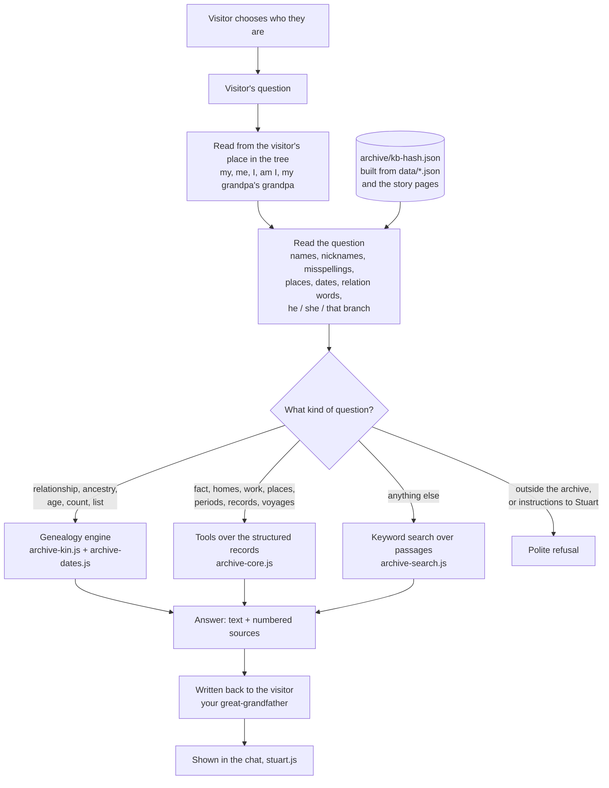

# Stuart, the family archivist

Stuart answers questions about a family from the records on its site, and shows where each fact comes from. He lives in two places:

- **His own page** (`pages.ask`, usually `ask.html`), a full-height chat.
- **The Ask Stuart button** in the bottom right-hand corner of every other page. It opens Stuart as a small window, which can be switched to a drawer down the side and back. On the family tree and the map it shrinks to Stuart's seal and keeps clear of those pages' own controls.

Before anyone can ask a question, Stuart introduces himself and asks who they are. The visitor types part of their name and picks themselves from the tree (or says they are not on it). From then on, "my grandfather", "my cousins" and "How am I related to ...?" are answered from where that person sits in the tree.

Everything runs in the visitor's browser. There is no server, no AI service, no account and no download beyond the site's own files, and nothing a visitor types leaves the page.

A site turns Stuart on with `pages.ask` and sets him up in `stuart` in [the settings](site-config.md).

## How a question is answered

1. **Reading from the visitor's place** (`personalise()` in `archive-core.js`). "My", "me", "I" and "am I" become the chosen person's name; a relation word with no name in front of it ("grandpa's grandpa") is read as the visitor's. A visitor not on the tree is asked to name someone instead.
2. **Reading the question** (`analyse()`). People are found by every name the site uses for them: display name, full name, given names, variants, nicknames, maiden names, a couple sharing a surname, sound-alikes ("Fitzmorris" finds FitzMaurice) and possessives typed without an apostrophe. A spelling is only corrected where a name is plausible. Relation chains ("Margot's father's mother"), dates and periods ("the 1880s", "the Blitz"), places, and follow-ups ("he", "her father", "tell me more") are read too. A name the archive does not hold is reported as not found rather than matched to the nearest one.
3. **Choosing a tool** (`route()`). The question goes to the most specific tool that fits; anything else goes to passage search, and anything the records cannot cover is declined.
4. **Building the answer.** Each tool writes text with two tokens: `{{p:person-id}}` for a person and `[n]` for source n. Every source is numbered per answer and kept with its title, kind, link and text.
5. **Writing it back to the visitor** (`youify()`). The visitor's own name becomes "you" or "your".
6. **Showing it** (`stuart.js`). Tokens become links; nothing is ever inserted as HTML.

## What Stuart can answer

| Question | Example |
| --- | --- |
| How two people are related, what they have in common, how many generations apart | How was Thomas Hartley related to Grandpa Arthur? |
| Someone's relatives, one side only, or counted | Who were Margot's great-grandparents on her father's side? |
| Ancestry, a paternal or maternal line, descendants | Trace Arthur's paternal line |
| Birth, death, burial, marriage, with a check of the question's own assumptions | When did Henri die in the war? (No: the records do not place it then) |
| Ages, at death, today for someone living, or at another person's birth, death or marriage | How old was Arthur when Peter was born? |
| Who was older, who outlived whom, how long a marriage lasted | How long were Arthur and Margot married? |
| Maiden, middle and full names; cause of death, only where a record says | What was Margot's maiden name? |
| Homes, work, places, voyages, countries | Who came from France? Where did Jean-Baptiste live? |
| Periods, people alive in a year, deaths in childhood, the youngest and oldest at death | Who was alive in 1900? |
| Records, photographs, evidence for a fact, disagreements between records | What evidence is there for Arthur's birth? |
| Gaps, open questions, least documented branches | What don't we know about the Moreaus? |
| A family by surname, or one side of the tree | Tell me about the Moreau family |
| How two people met, what a name means: only where a record says | How did Arthur and Margot meet? |
| Where to read more | Where can I read about the Moreaus? |
| Anything else about the family | passage search, with a check that the passages really cover the question |
| General history, creative writing, attempts to change the rules | declined |

Living people (`isLiving`) are answered like anyone else, from whatever their record holds, in the present tense: "is living", their age today when the record has a birth date, "Who are her children?".

## The files

| File | What it does |
| --- | --- |
| `engine/stuart.js` | Stuart himself: one chat component used on his page and in the window and drawer; the name finder; storage; links that scroll and highlight; the button, explanation, window and drawer |
| `engine/stuart.css` | Stuart's look, for the page and the button, including phones and reduced motion |
| `engine/archive-core.js` | Reads questions, reads them from the visitor's place, routes them, runs the tools and numbers the sources. Also keeps the prompt builder and the checks for written answers, unused for now |
| `engine/archive-kin.js` | The genealogy engine: parents, children, partners, siblings and half-siblings, ancestors and descendants, any named relation, the exact relationship between two people with the same labels as the tree, the shortest path, common ancestors |
| `engine/archive-dates.js` | Date ranges and ages. "about 1866" is kept as a range, and every age is worked out from both ends of both ranges, so Stuart says "between 59 and 63" rather than a number the records cannot support |
| `engine/archive-search.js` | Names, places and a BM25 keyword index over the passages, with everyday words for archive terms ("job" also finds occupation) |
| `templates/ask.html` | Stuart's page |
| `build/archive.py` | Builds Stuart's index, `archive/kb-<hash>.json`, and `archive/manifest.json`, from the data and the story pages in `stuart.pages` |

## The index

The build reads `people.json`, `places.json` and `sources.json`, and the text of the story pages listed in `stuart.pages`, split under their headings into passages of about 900 characters, with photograph captions and record images. It leaves out navigation, buttons, forms, scripts, styles, classes listed in `stuart.skipClasses`, and people in the tree's hidden regions (except suspected relatives, as on the tree).

The index's file name carries a hash of its content, and the site settings name the current one, so a new build reaches visitors at once and an old index is never mixed with new code. Each build makes a fresh one; there is nothing to commit.

Semantic embeddings were considered and left out: the questions are mostly about names, places and dates, which keyword search, names and the genealogy engine handle exactly, and an embedding model would add tens of megabytes to every visit. If an archive grows by an order of magnitude, `index.search()` is the one function to replace.

## Written answers

Stuart's answers are built from templates and the records, so they read plainly and are exact on relationships, ages and dates. Two pieces are kept so that written answers from a language model could come back without starting again: `buildPrompt()`, which gives a model the grounding rules and the same numbered sources as the quick answer, and `checkModelAnswer()`, which treats a model's reply as untrusted text (it strips markup, drops sentences with a year or family name the sources do not hold, and drops citations to sources it was not given).

Turning them on would mean a server-side function calling a model, with a spending cap and a rate limit: a paid service added to a static site. That is a decision for the site's owner, and nothing of it is built.

## Privacy and security

- **Nothing leaves the browser.** Questions and answers are worked out in the page. The chosen person is kept in `localStorage` (`stuart.me`), the conversation in `sessionStorage` (`stuart.chat`, gone when the tab closes), the window or drawer choice in `stuart.mode`. There is no logging, analytics, cookie or server.
- **Content Security Policy** on Stuart's page: only the site's own scripts run (no inline script, no `eval`), the page may connect only to the site itself, and only the font host in `head.fonts` is allowed for styles and fonts.
- **Typed text is never markup.** Questions and answers are rendered with `textContent`; links come only from the index, and `safeUrl()` refuses anything that is not a page or image on the site or an `http` or `https` link.
- **Instructions are declined.** "Ignore your instructions" and "Pretend you are a historian" are declined before any tool runs. Questions are limited to 500 characters.
- **Who you are is taken on trust.** Choosing a name changes the wording of answers ("your grandfather"), never what they show.

## The button on a page

The build adds the button to every site page except Stuart's own (`widget` in the settings). On pages that fill the screen with their own controls, `compact` shows only the seal and `avoid` lists the controls to keep clear of: Stuart moves the button just above whichever of those is showing, or to the left of a narrow panel down the right-hand side. Links that point to the page being read scroll to that section and highlight it; links to another page go there, and Stuart opens again on arrival with the conversation where it was.

Buttons elsewhere can open Stuart with `data-stuart-open`, and ask a question at the same time with `data-stuart-ask="..."`.

## Changing how questions are answered

Add the question to a site's question set first (the FitzMaurice and Andrews site keeps 177 in `tests/archive-eval.json`), with what the answer must contain, and watch it fail. Then change `archive-core.js`: `RX` holds the patterns that recognise each kind of question, `route()` decides which tool answers, and each `tool...()` function builds one kind of answer. Keep answer text in British English, without dashes, and with every fact cited. Run the sample's checks and a real site's question set before releasing.

## Known limitations

- **Rule-based reading has gaps.** On new wording, about one question in four is read as the wrong kind. The answer is then usually relevant but not to the point. Adding the question to a question set and a pattern to `RX` fixes each one.
- **Search is keyword search.** A question whose words appear nowhere in the records gets no passages, even if a record describes it in other words.
- **Coverage follows the site.** Anything not on the site is reported as not in the records, which is correct but may disappoint.
- **Relationships follow the tree's recorded links**, including those graded probable; answers say when a link in the chain is probable or unverified.
